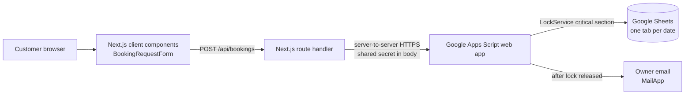
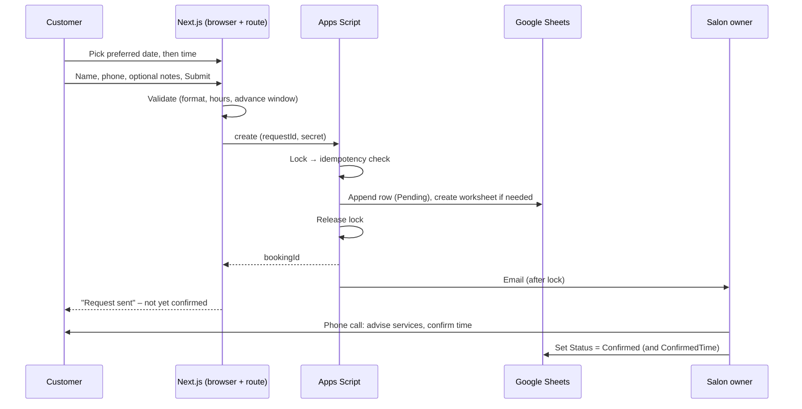

# 2IN.CORNER — Nail Salon Landing Page & Appointment Requests

A mobile-first landing page for the **2IN.CORNER** nail salon. Customers pick a **preferred date and time**, leave their name and phone number, and submit an **appointment request**. The request is stored in **Google Sheets** by a **Google Apps Script** web app, which also emails the salon owner. The owner then phones the customer to discuss services and confirm the actual appointment.

- **Target users:** salon customers (guests – no account, no payment, no service selection) and the salon owner (works directly in Google Sheets).
- **Language:** the website is in Vietnamese; this documentation is in English.
- **Model:** this is an *appointment request* system, not an automatically confirmed booking system. Several customers may request the same time; the owner resolves the final schedule by phone.

> Developer/AI-assistant rules live in [`CLAUDE.md`](CLAUDE.md).

## Theme and brand font

- Light/Dark toggle in the navbar. Persistence: `localStorage["theme"]` (`light`/`dark`); with no saved choice the system colour scheme is used. An inline script in `src/app/layout.tsx` applies the `dark` class before first paint (no flash, no hydration mismatch).
- Grayscale tokens (`src/app/globals.css`) — Light: page `#e5e5e5`, secondary `#f5f5f5`, surface `#ffffff`, text `#222222`/`#555555`, border `#d4d4d4`. Dark: page `#242424`, secondary `#303030`, surface `#383838`, text `#f5f5f5`/`#c4c4c4`, border `#525252`.
- COMBO SALE (`comboSale` in `src/config/services.ts`) is a promotional category with display-only prices for customers who book in advance; its link just scrolls to the request form and the owner confirms manually.
- The Services price menu is always black and white (marble background), independent of the theme.
- Bitcount Ink (`next/font/google`) is applied only to the brand name "2IN.CORNER" through the `.brand-font` class.

## Features

| Feature | Status | Where |
|---|---|---|
| Responsive landing page (hero, how-it-works, services, request form, gallery, contact) | Implemented | `src/app/page.tsx` |
| "Serene beauty spa" UI: soft pastel palette, Cormorant Garamond + Be Vietnam Pro fonts, floating header, accessible focus states, reduced-motion support | Implemented | `src/app/globals.css`, `src/app/layout.tsx`, `src/components/Header.tsx`, `Footer.tsx` |
| Service showcase (informational only – not part of the request) | Implemented – display-only price menu (CLASSIC / NAIL CARE / EXTENSIONS / DESIGNS / DISCOUNT) | `src/components/ServicesSection.tsx`, `src/config/services.ts` |
| Preferred date + time selection (opening hours, 30-min grid, lead time, 30-day window) | Implemented | `src/components/booking/BookingRequestForm.tsx`, `src/lib/booking/schedule.ts` |
| Server-side validation (name, phone, date/time, hours) | Implemented | `src/lib/booking/validation.ts` |
| Request idempotency (`requestId`) and lock-protected writes | Implemented | `google-apps-script/Code.gs`, `BookingRequestForm.tsx` |
| Google Sheets storage, one worksheet per date, created automatically | Implemented | `Code.gs` |
| Owner email notification + status tracking + 15-minute retry trigger | Implemented | `Code.gs` |
| Top information bar above the navbar: opening hours (text only), address (Google Maps link) and phone (`tel:`); each item appears only when configured, and the bar is hidden if none are | Implemented – **needs owner's details** | `src/components/TopInfoBar.tsx` |
| "Đặt lịch qua Zalo" and "Gọi điện đặt lịch" buttons (hero, booking, contact) + mobile sticky bar; each appears only when configured | Implemented – **needs owner's Zalo link and phone** | `src/components/ContactButtons.tsx`, `StickyContactBar.tsx`, `src/lib/contact.ts` |
| Manual confirmation by phone, status edited in Sheets | Process (no code) | — |
| Gallery strip on the home page and `/gallery` from local config | Implemented – **hidden until real photos are added** | `src/config/gallery.ts` |
| Testimonials and before/after sections | Implemented but **hidden until real content is added** | `src/config/showcase.ts` (empty lists) |
| Contact section / footer links | Implemented, **hidden until filled in** | `src/config/salon.config.ts` (empty values) |
| Service selection, pricing, duration or overlap checks in the request flow | **Removed** (owner's requirement) | — |
| Customer accounts, online payment, customer emails, admin dashboard | **Not implemented** | — |

## Ways to book

| Option | What happens | Creates a record / email? |
|---|---|---|
| **Gửi yêu cầu đặt lịch trực tuyến** (form) | Request saved to the day's Google Sheets tab as `Pending`, owner emailed, owner phones back | **Yes** |
| **Đặt lịch qua Zalo** | Opens the owner's Zalo link (new tab / Zalo app); the conversation happens in Zalo | **No** – nothing is stored by this site and no email is sent |
| **Gọi điện đặt lịch** | `tel:` link starts a phone call | **No** – nothing is stored by this site and no email is sent |

Zalo and phone are plain links: the owner must note those appointments manually. The Zalo/phone buttons are hidden until configured (see [Environment configuration](#environment-configuration)); the sticky bar (mobile only) shows Gọi điện / Zalo / Đặt lịch and hides itself while the request form is on screen.

## Technology stack

Versions are the ones installed in `node_modules` (declared ranges in `package.json`).

| Technology | Purpose | Version | Current usage |
|---|---|---|---|
| Next.js (App Router, Turbopack) | Pages, route handlers | 16.3.0 (`^16.3.0`) | Active |
| React | UI | 19.2.8 | Active |
| TypeScript | Typing | 5.9.3 | Active (`strict`, `@/*` → `src/*`) |
| Tailwind CSS | Styling (`@tailwindcss/postcss`, theme in `globals.css`) | 4.3.3 | Active |
| ESLint + `eslint-config-next` | Linting | 9.39.5 / 16.3.0 | Active |
| `next/font/google` | Cormorant Garamond, Be Vietnam Pro | — | Active |
| Google Apps Script (V8) | Request backend | — | Active (`google-apps-script/`) |
| Google Sheets | Request storage | — | Active |
| `MailApp` | Owner email | — | Active |
| Node.js | Runtime / tooling | 20.9+ required by Next 16; 24.x used in development | Active |

## System architecture



- The browser **never** talks to Apps Script. Only the route handler does, using `GOOGLE_APPS_SCRIPT_URL` / `GOOGLE_APPS_SCRIPT_SECRET`.
- Next.js validates the input; Apps Script re-validates, de-duplicates by `requestId` and writes the row.
- **No backend, database or authentication.** The earlier .NET API / account system is no longer used by the site; its frontend client, login/register/my-bookings/staff pages and old booking form were removed. Marketing content (services, gallery, testimonials, contact details) lives in `src/config/`. The .NET backend and its database are not part of this repository and, if still hosted anywhere, can be decommissioned separately by the owner.

## Project structure

```text
.
├── CLAUDE.md                     # Rules for Claude Code sessions
├── README.md
├── env.example                   # Environment template (copy to .env.local)
├── google-apps-script/
│   ├── Code.gs                   # Request backend (doPost, locking, Sheets, email)
│   ├── appsscript.json           # Manifest: time zone, scopes, web-app access
│   ├── README.md
│   └── docs/                     # Setup, deployment and rules reference
├── src/
│   ├── app/
│   │   ├── layout.tsx            # Fonts, metadata, header/footer shell
│   │   ├── page.tsx              # Landing page
│   │   ├── globals.css           # Design tokens (re-tinted rose scale, cream/lavender/sage)
│   │   ├── api/bookings/route.ts # POST /api/bookings
│   │   ├── book/                 # /book → redirects to /#booking
│   │   ├── gallery/              # /gallery (from src/config/gallery.ts; 404 while empty)
│   │   └── services/             # /services → redirects to /#services
│   ├── components/
│   │   ├── booking/BookingRequestForm.tsx  # Date, time, name, phone, notes (client)
│   │   ├── ServicesSection.tsx             # Informational price menu (marble background, categories)
│   │   ├── TopInfoBar.tsx                  # Hours / address / phone bar above the navbar
│   │   ├── ContactButtons.tsx  StickyContactBar.tsx  # Zalo / phone CTAs (render only when configured)
│   │   ├── Header.tsx  Footer.tsx  form.tsx
│   │   └── Testimonials.tsx  BeforeAfter.tsx   # Render nothing when no real content
│   ├── config/
│   │   ├── services.ts           # Price menu categories (display-only price strings)
│   │   ├── gallery.ts            # Gallery photos (empty)
│   │   ├── booking.config.ts     # Hours, slot size, advance window, time zone
│   │   ├── salon.config.ts       # Contact details (env-driven) and social links
│   │   └── showcase.ts           # Testimonials / before-after (empty)
│   └── lib/
│       ├── booking/
│       │   ├── schedule.ts  time.ts  validation.ts   # Pure rules
│       │   ├── booking-service.ts      # Validation → gateway → HTTP result
│       │   ├── apps-script-gateway.ts  # Server-only Apps Script client
│       │   ├── rate-limit.ts  types.ts
│       ├── contact.ts            # tel: / https URL helpers
│       └── format.ts             # VND formatting
├── public/                       # Static assets (currently empty)
└── next.config.ts  tsconfig.json  eslint.config.mjs  postcss.config.mjs
```

## Booking workflow



1. The customer chooses a preferred date (today … +30 days) and a preferred time within opening hours.
2. The customer enters full name, phone number and optional notes. No services are chosen.
3. The browser sends `POST /api/bookings` with a per-form `requestId`.
4. The server validates the request; Apps Script re-checks it and, inside a lock, looks for the same `requestId`.
5. A new row with status `Pending` is appended to the worksheet for the preferred date.
6. The owner receives an email; the customer sees a message that the request was sent and is **not yet confirmed**.
7. The owner phones the customer, discusses services, and sets `Confirmed` / `Cancelled` (and `ConfirmedTime`) in the sheet.

## Booking business rules

Defaults live in `src/config/booking.config.ts`. Hours are **unconfirmed defaults** (09:00–20:00 every day) and must be confirmed before production.

| Rule | Behavior (as implemented) |
|---|---|
| Nature | Appointment *request*: the chosen date/time is a **preference**. No end time, price or duration is calculated |
| Same time | Different customers **can** request the same date and time; all are saved as `Pending`. The owner decides the final schedule |
| Statuses | `Pending` (default), `Confirmed`, `Completed`, `Cancelled`. Status is informational and edited by hand; it no longer affects acceptance of new requests |
| Time options | Every 30 min from opening time, last option before closing; shown for the chosen date |
| Lead time / window | ≥ 60 min from now; ≤ 30 days ahead; no past times |
| Time zone | `Asia/Ho_Chi_Minh`; dates/times are handled as plain strings/minutes |
| Idempotency | `requestId` is stored in the `RequestId` column; a retry returns the original request (HTTP 200) with no second row and no second email; reusing a `requestId` with a different phone/time is rejected |
| Concurrency | Apps Script `LockService` script lock (20 s timeout) around idempotency check + append, so concurrent retries cannot create duplicates; lock timeout → retryable 503 |
| Input | Name 2–80 chars; Vietnamese phone `0[2-9]xxxxxxxx` (`+84` normalized); notes ≤ 300 chars; formula-leading characters neutralized in Sheets |
| Not required | Services, prices, customer email, online payment, customer account |

## Google Sheets integration

One spreadsheet; **one worksheet per preferred date** named `DD-MM-YYYY` (e.g. `18-10-2026`). The script creates a worksheet (header row, frozen) on the first request for a date. Do not create daily tabs by hand.

Columns of a new worksheet, in order:

`BookingId, RequestId, CreatedAt, CustomerName, PhoneNumber, PreferredDate, PreferredTime, Notes, Status, ConfirmedTime, EmailNotificationStatus, EmailSentAt, EmailAttempts`

(`EmailAttempts` is bookkeeping for the email retry job.)

- **Backward compatibility:** the script finds columns **by header name**. A worksheet created by the earlier service-based version keeps all its columns and rows untouched; the script only appends missing columns (e.g. `PreferredDate`, `PreferredTime`, `ConfirmedTime`) to the right of its header. Old rows keep their `StartTime`/`BookingDate`/service data. Nothing is deleted or overwritten.
- Request IDs look like `BK-20261018-001`. Times are stored as `HH:mm` text, phones as text (leading `0` preserved).
- **Owner workflow:** read the email → phone the customer → set `Status` to `Confirmed` or `Cancelled` and optionally fill `ConfirmedTime`. Change only those cells by hand.
- **Limitations:** Sheets has no transactions (hence the script lock); Apps Script quotas apply; the sheet will not warn you about two requests for the same time – check the day's tab when confirming.

## Google Apps Script

`google-apps-script/Code.gs` is a Web App (`doGet` health check, `doPost` API).

**Responsibilities:** authenticate requests · validate required fields · create/extend daily worksheets · idempotency by `requestId` · append the request under a lock · owner email via `MailApp` · `retryPendingEmails` (time-driven) re-sends failed notifications. There is no overlap validation.

**Action (`POST` JSON body):** `create`.

**Authentication:** a shared secret sent in the JSON body (`secret`), compared in constant time with the `API_SECRET` Script Property. Apps Script web apps cannot read custom headers and an "Anyone" deployment cannot identify the caller, so the `/exec` URL must be treated as private and the secret rotated if leaked (change the Script Property and the Vercel variable).

**Script Properties**

| Property | Required | Purpose |
|---|---|---|
| `API_SECRET` | Yes | Must equal `GOOGLE_APPS_SCRIPT_SECRET` |
| `ADMIN_EMAIL` | Yes | Recipient of new-request emails (the salon owner) |
| `SPREADSHEET_ID` | No | Only if the script is not bound to the spreadsheet |

**Deployment**

1. Create a Google Spreadsheet (no daily tabs needed) → **Extensions → Apps Script**.
2. Paste `Code.gs`; enable the manifest file and paste `appsscript.json` (time zone `Asia/Ho_Chi_Minh`, V8).
3. Set the Script Properties above.
4. Run `installTriggers` once (authorize) to schedule the 15-minute email retry.
5. **Deploy → New deployment → Web app**: *Execute as* **Me**, *Who has access* **Anyone**. Copy the `/exec` URL.
6. After every code change: **Manage deployments → Edit → New version** (the URL stays the same). **The earlier deployment runs the old service-based script until you do this.**

**Permissions (scopes):** Google Sheets (`spreadsheets`), sending mail (`script.send_mail`), triggers (`script.scriptapp`).

**Manual check:** open the `/exec` URL in a browser – it must return only `{"ok":true,"service":"2in-corner-booking"}`.

**Owner email** (subject `[2IN.CORNER] New Appointment Request - 18/10/2026 10:00`): customer, phone, preferred date/time, notes (`None` if empty), status `Pending`, a reminder to phone the customer, and the worksheet link. Only the owner is emailed; customers never are. A request is never rolled back if the email fails (`EmailNotificationStatus` becomes `Failed`, then the trigger retries up to 5 attempts). Delivery is at-least-once; consumer Gmail accounts have a daily send quota (~100).

## Environment configuration

Defined in `env.example` (copy to `.env.local`; `.env*` files are git-ignored).

| Variable | Purpose | Required | Example |
|---|---|---|---|
| `GOOGLE_APPS_SCRIPT_URL` | Apps Script Web App `/exec` URL (server-only) | Yes, for requests | `https://script.google.com/macros/s/<DEPLOYMENT_ID>/exec` |
| `GOOGLE_APPS_SCRIPT_SECRET` | Shared secret = Script Property `API_SECRET` (server-only) | Yes, for requests | `<random-hex-string>` |
| `NEXT_PUBLIC_SALON_PHONE` | Salon phone, human-readable (shown in the UI; normalized for the `tel:` link) | Optional – hides the call button if empty | `0901 234 567` |
| `NEXT_PUBLIC_SALON_ADDRESS` | Salon address (top bar, contact section) | Optional | `<street, ward, city>` |
| `NEXT_PUBLIC_SALON_HOURS` | Opening hours as display text (top bar, contact section; no open/closed logic) | Optional | `<e.g. Thứ 2 – CN, 9:00 – 18:30>` |
| `NEXT_PUBLIC_GOOGLE_MAPS_URL` | Link to the salon on Google Maps (must be `https://`); makes the address clickable | Optional | `https://maps.app.goo.gl/<id>` |
| `NEXT_PUBLIC_GOOGLE_MAPS_EMBED_URL` | Google Maps **Embed** URL for the map beside the contact info. Get it from Google Maps -> Share -> Embed a map -> copy only the `src` value of the iframe (`https://www.google.com/maps/embed?...`). A normal share link (`maps.app.goo.gl`) is not valid here. On Vercel: Project -> Settings -> Environment Variables, then redeploy. If missing or invalid, the map is replaced by a placeholder with the "Mở Google Maps" link (needs `NEXT_PUBLIC_GOOGLE_MAPS_URL`); with neither, the map panel is hidden. | Optional | `https://www.google.com/maps/embed?pb=...` |
| `NEXT_PUBLIC_ZALO_URL` | Official Zalo link from the owner (must be `https://`) | Optional – hides the Zalo button if empty | `https://zalo.me/<phone-or-id>` |

Never prefix the Google variables with `NEXT_PUBLIC_`. The two contact variables are public by nature and are inlined at build time, so redeploy after changing them. Without them `POST /api/bookings` responds `503` while the page still renders.

## Local development

Prerequisites: Node.js 20.9+ (24.x tested) and npm.

```bash
npm install
cp env.example .env.local      # then fill in the two Google variables
npm run dev                    # http://localhost:3000
```

Other scripts (from `package.json`): `npm run build`, `npm start`, `npm run lint`; type check with `npx tsc --noEmit`. No other services are required.

## API documentation

### `POST /api/bookings`

Submits an appointment request. Messages are Vietnamese; responses are `Cache-Control: no-store`.

```json
{
  "requestId": "unique-id-16-to-64-chars",
  "customerName": "Nguyen Van A",
  "phoneNumber": "0901234567",
  "preferredDate": "2026-10-18",
  "preferredTime": "10:00",
  "notes": ""
}
```

Success – `201` (new) or `200` (idempotent replay):

```json
{ "success": true, "bookingId": "BK-20261018-001", "status": "Pending", "message": "Đã gửi yêu cầu đặt lịch thành công." }
```

Errors use `{ "success": false, "code": "…", "message": "…" }` (plus `errors` per field for validation, `retryable` for upstream failures):

| HTTP | `code` | Meaning |
|---|---|---|
| 400 | `INVALID_REQUEST` | Validation failed (name, phone, date/time format, outside hours, past/too-soon/too-far, body > 8 KB, malformed JSON, reused `requestId` with different content) |
| 429 | `RATE_LIMITED` | More than 8 requests / 10 min per IP (in-memory, best effort) |
| 503 | `SERVICE_UNAVAILABLE` | Apps Script/Sheets unreachable, misconfigured, or lock timeout; `retryable` is included |

There is no `409` conflict: two requests for the same time are both accepted. Unknown fields (e.g. old `serviceIds`) are ignored.

**Removed:** `GET /api/bookings/availability` no longer exists – with no overlap rule there is nothing to check, and the form builds its time options locally from `src/config/booking.config.ts`.

## Deployment

No deployment config file (e.g. `vercel.json`) is committed; Vercel's defaults for Next.js apply.

**Vercel**

1. Import the repository; the **project root is the repository root** (where `package.json` lives).
2. Build command `next build` (default `npm run build`), framework preset Next.js.
3. Set `GOOGLE_APPS_SCRIPT_URL` and `GOOGLE_APPS_SCRIPT_SECRET` for Production (and Preview if used). Add the optional `NEXT_PUBLIC_*` contact variables.
4. The route handler sets `maxDuration = 30` because Apps Script can take several seconds.

**Google side:** deploy the Apps Script as described above (execute as the spreadsheet owner, access "Anyone"); keep the spreadsheet shared only with the owner/admins – customers never access it. Deploy the Next.js app and the **new Apps Script version together**: the new API payload is not understood by the old script.

**Before going live:** set `NEXT_PUBLIC_SALON_PHONE`, `NEXT_PUBLIC_ZALO_URL`, `NEXT_PUBLIC_SALON_ADDRESS`, `NEXT_PUBLIC_SALON_HOURS` and `NEXT_PUBLIC_GOOGLE_MAPS_URL`, confirm opening hours, replace placeholder services/prices (showcase only), fill `salon.config.ts`, run `installTriggers`, and place a real test request (check the row and the email, then delete the row).

## Troubleshooting

| Symptom | Likely cause / fix |
|---|---|
| Submitting returns 503 | `GOOGLE_APPS_SCRIPT_URL`/`SECRET` missing or wrong (redeploy after changing Vercel env vars); Apps Script not deployed as Web App |
| Apps Script returns an HTML login page | Deployment access is not "Anyone", or the URL is the editor/`/dev` URL – use the `/exec` URL |
| `UNAUTHORIZED` from the script | `API_SECRET` differs from `GOOGLE_APPS_SCRIPT_SECRET` (check whitespace) |
| Requests rejected as invalid after upgrading | Apps Script still runs the old version – create a **new version** in *Manage deployments* |
| Sheet permission errors / "Service unavailable: Spreadsheets" | Re-authorize the script; the deploying user must own/edit the spreadsheet; check `SPREADSHEET_ID` |
| Two requests for the same time | Expected: both are saved as `Pending`; resolve by phone |
| Owner email missing | `ADMIN_EMAIL` unset, mail quota reached, or check `EmailNotificationStatus`; the 15-minute trigger retries `Failed` rows (run `installTriggers`) |
| Gallery section / nav link missing | `src/config/gallery.ts` is empty – add real photos |
| Time options look wrong near midnight | Dates use `Asia/Ho_Chi_Minh`; make sure the script manifest time zone matches |
| Stale type error about a deleted route after upgrading | Delete the `.next` folder and rebuild |

## Future improvements

Not implemented – ideas only:

- Multiple technicians and a real schedule with overlap checks once the owner wants automatic confirmation
- Admin dashboard and authenticated management UI
- Rescheduling and cancellation by customers
- Customer notifications (SMS/Zalo/email)
- Analytics and reporting
- Database-backed storage with real transactions, plus a shared-store rate limiter
- Real service images, testimonials and before/after photos supplied by the salon
